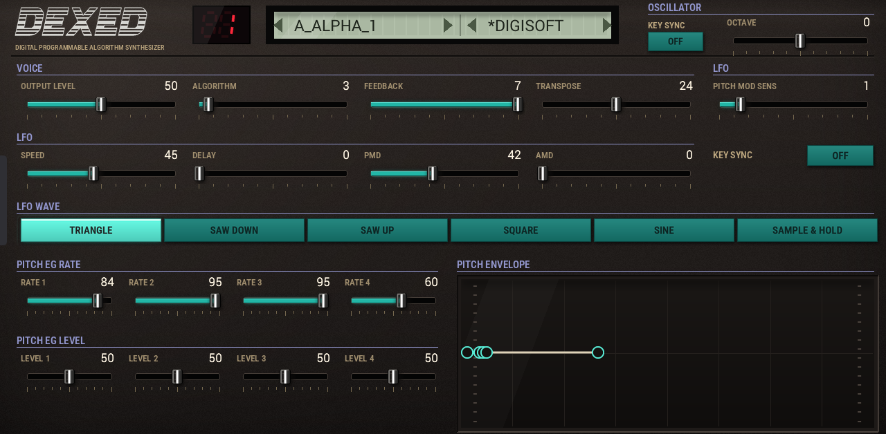
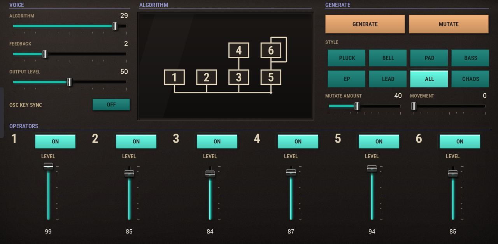
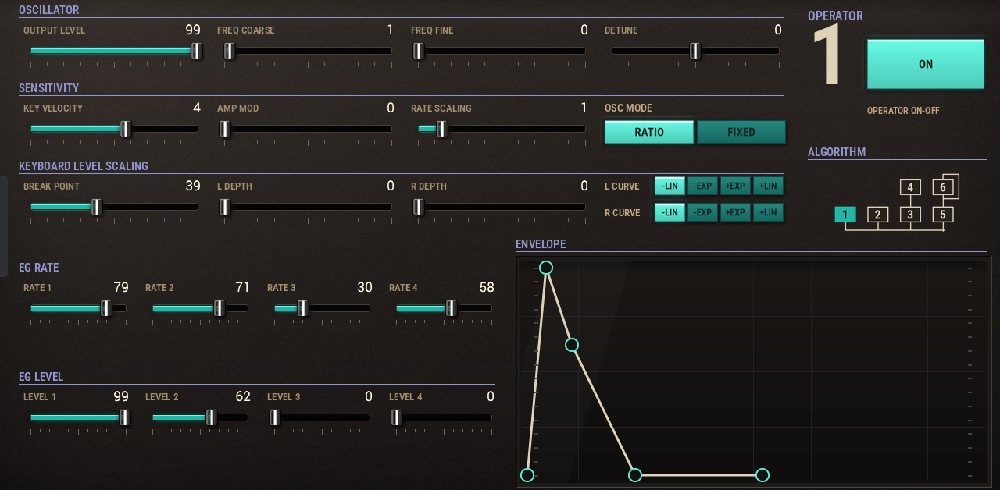
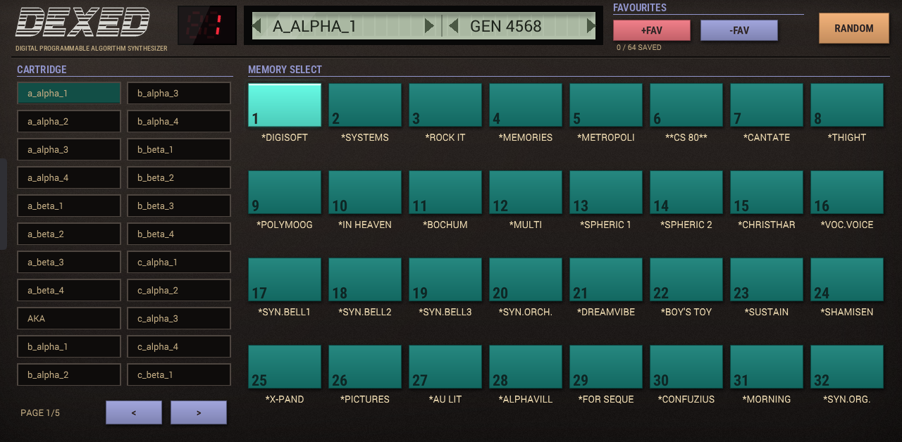

# Dexed (DX7) VST Plugin for MPC OS

💬 Questions or feedback? Join the [Open MPC Discord](https://discord.gg/sRRysZSgu3).

**Dexed (DX7)** as a native VST2 instrument for Akai MPC OS standalone devices (MPC Live/One/X/Key,
Force). It loads in MPC's built-in plugin host and has its own DX7-style touchscreen skin with Q-Link support.

Current release: **v2.0.0**, see [Releases](https://github.com/sd88me/mpc-vst-dx7/releases).
2.0 is an update of 1.x: same plugin name and ID, so existing projects load, and your own carts in `dx7_carts` are kept.

## Screenshots

VOICE: the LCD with the cart and patch, the voice controls, the LFO and the pitch envelope.



ALGO: the algorithm diagram, an operator mixer and GENERATE.



OP1 to OP6 (one key, six sub-tabs): oscillator, sensitivity, keyboard level scaling and the operator's envelope.



CARTS: every cart on the device, the 32 patches of the loaded one, and favourites.



## Features

- Yamaha DX7-style 6-operator FM synthesis (the Dexed/MSFA engine): all 32 algorithms, feedback, oscillator sync, the LFO
  (six waveforms, key sync) and the pitch envelope.
- **A new skin drawn like the DX7 panel**: DEXED wordmark, red LED patch number, an LCD with the cart and patch side by side.
  Horizontal sliders with a lit fill, Q-Link bounds in blocks of four on every page.
- **VOICE**: output, algorithm, feedback, transpose, octave, oscillator sync, the LFO and an interactive pitch envelope.
- **CARTS**: every `.syx` cart on the device (paged tiles, the current one lit), the 32 patches of the loaded cart, a RANDOM
  button (random cart and patch), and a **favourites** row.
- **Favourites in the PRESET menu**: +FAV saves the current voice (with your edits); the saved voices appear in MPC's own
  PRESET list, so you can pick them from the track or from a pad. -FAV removes the one you are on. Stored in `favourites.dat`
  in the plugin folder.
- **ALGO**: the algorithm diagram, the VOICE controls, an operator mixer (ON and level per operator) and **GENERATE**.
- **GENERATE**: a random voice with musical rules. Pick a STYLE (PLUCK, BELL, PAD, BASS, EP, LEAD, ALL, CHAOS) and press
  GENERATE for a new voice, or MUTATE to vary the current one by the AMOUNT slider. Carrier ratios (the key note) are kept,
  carriers always fade to silence on release; CHAOS follows no rules for happy accidents. Generated patches are named GEN nnnn.
- **OP**: one key with six sub-tabs, one per operator: level, coarse, fine, detune, velocity sensitivity, amp mod, rate
  scaling, RATIO/FIXED, key scaling, a live draggable EG graph and the operator's ON switch.
- The cart and patch on the LCD step with the Q-Links and the data wheel.
- `.syx` carts: single 4104-byte banks or multi-bank ROM dumps (any exact multiple of 4104 bytes); a set of factory banks is included.

## Requirements

- An MPC OS standalone device (Force, MPC Live / Live II / III, One, X, Key 61). Tested on a Force.
- Root SSH access to the device for the installer. Installing plugins this way is unofficial: back up first, use at your own risk.

## Install

1. Download the zip for your device from the [latest release](https://github.com/sd88me/mpc-vst-dx7/releases/latest)
   (`Dexed-DX7-2.0.0-mpc-armv7.zip` for the Force, Live, One, X and Key; `-aarch64` for the newer Gen 2 units) and unzip it.
2. Copy the folder to the device and run the installer (it stops MPC, so save your project first):

   ```
   scp -r Dexed-DX7-2.0.0 root@<device-ip>:/tmp/
   ssh root@<device-ip> sh /tmp/Dexed-DX7-2.0.0/install.sh
   ```

3. Add **Dexed (DX7)** to a track from the plugin browser (Instrument plugins).

The zip's `INSTALL.md` has the manual steps and the uninstall command. Running the installer again upgrades in place, keeping
your own carts and favourites. After replacing the plugin file on a running device, remove and re-insert the plugin on any
track that uses it.

### Bank and patch carts

The plugin reads `.syx` files from the `dx7_carts` folder inside its own plugin folder
(`/sdcard/Synths/sd88me - VST - Dexed (DX7)/dx7_carts`). The installer puts the factory banks there; drop your own files in the
same folder and they appear in the cart list on the CARTS page and on the LCD.

## Build from source

`./build-sdk.sh test` builds the plugin and runs its host test; the skin is generated from Python (`tools/make_tui.py`,
`tools/skin_pages.py`, `tools/make_dx7_skin.py`). `release.sh`-style packaging for the installer zips is described in
`mpc-vst-plugins`' `docs/RELEASING.md`. The 32 algorithm diagrams in `images/` come from `tools/gen_algo_svgs.py`.

The skin art is drawn by the tools from code; the fonts in the art are open-licence (Roboto Condensed).

## Status

v2.0.0. Checked on a real Force: installing over 1.x with the installer, the plugin loads from the plugin browser and its pages
draw. The author also ran this build on an MPC Live III. The host test (`./build-sdk.sh test`) passes. Not yet checked: loading a
project saved with 1.x (the parameter order is unchanged on purpose, so it should load; reports welcome).

## Background

The sound engine is a vendored copy of [schwung-dx7](https://github.com/charlesvestal/schwung-dx7),
a `plugin_api_v2` build of the Dexed/MSFA engine originally written for Ableton Move. `src/VENDORED.md`
lists exactly what is vendored, from which commit, and our local source changes. It is wrapped as an
MPC OS VST2 plugin with `mpc-vst-plugins`' shared tooling.

The screen layout started from [force-dx7](https://github.com/sd88me/force-dx7)'s Force Shadow page,
then was reworked for this plugin (the OP pages, ALGORITHM page, per-operator switches and palette are
specific to this port). This repo is purely the VST port; `force-dx7` remains the separate
MockbaMod/Force Shadow addon for the Force's own on-device app, a different architecture (a separate
host process, not a VST).

More detail: [docs/NOTES.md](docs/NOTES.md) (this port's findings, including the retired control-socket
attempt and each bug found on the device), [src/VENDORED.md](src/VENDORED.md) (what is vendored and why).

## Credits

- **Yamaha** — the original DX7 hardware and its 6-operator FM synthesis architecture.
- **[asb2m10](https://github.com/asb2m10)** — [Dexed](https://github.com/asb2m10/dexed), the
  original DX7 emulator/VST this all traces back to.
- **Google** — [MSFA](https://github.com/google/music-synthesizer-for-android), the FM synthesis
  core Dexed itself is built on (Apache-2.0, headers preserved as-is in `src/dsp/msfa/`).
- **[charlesvestal](https://github.com/charlesvestal)** —
  [schwung-dx7](https://github.com/charlesvestal/schwung-dx7), the `plugin_api_v2` build for Ableton
  Move this port vendors directly (see `src/VENDORED.md`).
- **[sd88me](https://github.com/sd88me)** — this MPC OS VST2 port, and
  [force-dx7](https://github.com/sd88me/force-dx7) (the separate Force Shadow addon this skin's
  layout and palette are ported from).

## License

GPL-3.0 (see `LICENSE`). The algorithm diagrams follow the layout table in Dexed's `AlgoDisplay.cpp`
(GPL-3.0); individual MSFA files keep their own Apache-2.0 headers.
